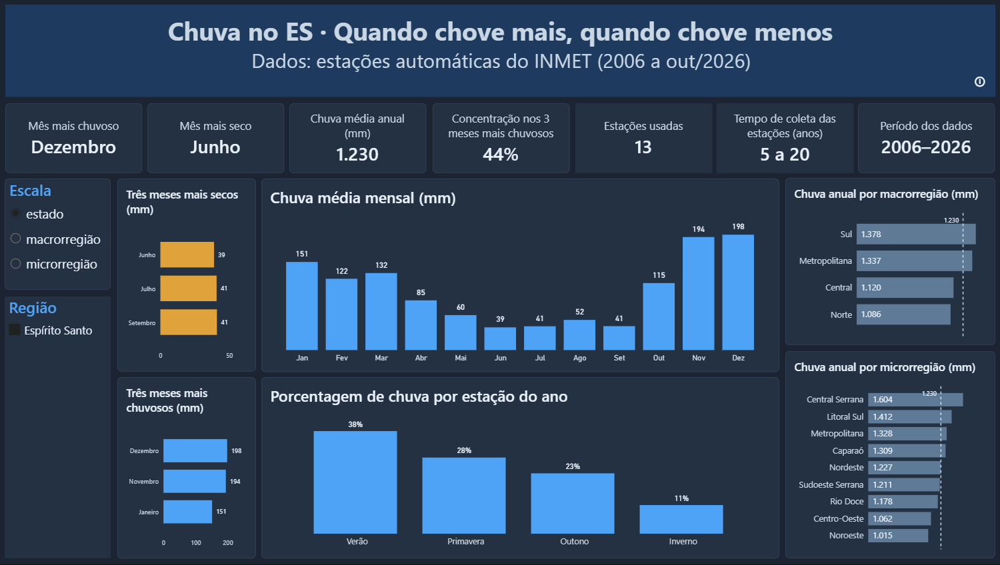

# chuva-es

*Pipeline automatizado de dados de chuva do INMET para o Espírito Santo — Python, PostgreSQL/PostGIS, QGIS e Power BI.*



*Página 1 do painel no Power BI (história de usuário 2), aberta na média do estado.*

## Por que este projeto

As chuvas no Espírito Santo apresentam regionalidades ao longo do território, variando muito entre litoral, região serrana e norte do estado, mas a rede de monitoramento automáticas do INMET tem apenas 11 estações em solo capixaba. Transformar esses registros em informação por região apoia decisões sobre estiagem, eventos extremos e gestão ambiental — como as que envolvem a SEAMA e sua Gerência de Gestão e Qualidade Ambiental.

## Visão do produto

Um painel de chuva do Espírito Santo com dois públicos:

- **Gestão pública (SEAMA):** dados para embasar decisões, sobretudo sobre mudanças climáticas e episódios críticos de chuva.
- **Sociedade:** informação aberta sobre o histórico de chuvas, para pesquisadores, jornalistas, turistas e a população.

O painel compara o ano atual (ou um ano escolhido) com a série histórica, por localidade, e mostra a chuva hora a hora das últimas 24 horas.

### Histórias de usuário

**1. Comparação com a série histórica**
> **Como** gestor da SEAMA, **quero** comparar a chuva acumulada do ano atual com a média histórica da macrorregião que eu escolher, **para** identificar se a região está mais seca ou mais chuvosa que o normal e embasar decisões sobre estiagem ou eventos extremos.

- [ ] Posso escolher uma macrorregião e um ano
- [ ] Vejo a chuva acumulada mês a mês, ao lado da média do período de referência
- [ ] Vejo, em destaque, quanto o acumulado está acima ou abaixo da média (%)
- [ ] O painel informa até que data os dados vão

**2. Período chuvoso e seco**
> **Como** morador ou turista, **quero** ver em quais meses mais chove na região, **para** planejar atividades no período mais adequado (plantio, obras, viagens).

- [x] Vejo a chuva média de cada mês do ano, para a região escolhida
- [x] Os meses mais secos e mais chuvosos aparecem destacados

**3. Informação para a imprensa**
> **Como** jornalista, **quero** saber se a chuva deste ano está acima ou abaixo do normal na região, **para** informar a população com dados oficiais quando houver estiagem ou excesso de chuva.

- [ ] Vejo o acumulado do ano comparado à média histórica, em percentual
- [ ] Vejo a fonte e a data da última atualização dos dados

**4. Acompanhamento das últimas 24 horas**
> **Como** gestor da SEAMA, **quero** ver a chuva hora a hora das últimas 24 horas nas estações do ES, **para** subsidiar a articulação da resposta do Estado, junto à Defesa Civil, em episódios de chuva intensa que possam evoluir para situações de emergência ou calamidade.

- [ ] Posso escolher uma estação e ver a chuva de cada hora das últimas 24 h, com o total acumulado
- [ ] O painel mostra o horário da última atualização
- [ ] O painel informa que os dados são de acompanhamento e não substituem os alertas oficiais da Defesa Civil e do Cemaden

### Limites declarados

- A rede de estações automáticas do INMET no ES é esparsa (11 estações), por isso chuvas muito localizadas podem não ser registradas.
- Com cerca de 18 anos de dados automáticos, o painel mostra **variabilidade**, mas não permite afirmar **tendências climáticas**, que exigem séries de 30 anos ou mais.

## O que o projeto entrega

- **Robô diário** que verifica diariamente se o INMET publicou dados novos e os processa
- **Banco de dados** PostgreSQL/PostGIS com estações, municípios e regiões
- **Mapas no QGIS** do estado e distribuição da chuva
- **Painel no Power BI** com análises regionalizadas

## Banco de dados

Banco PostgreSQL/PostGIS (`ambiental_es`) num modelo dimensional (esquema estrela): uma tabela de fatos com as medições, cercada de tabelas de dimensões que dão contexto a elas.

| Tabela | O que guarda |
|---|---|
| `f_medicao` | medições horárias de cada estação e variável, com horário em UTC; dado ausente é gravado como NULL, nunca como zero |
| `dim_estacao` | 13 estações automáticas do INMET no ES (11 em operação e 2 históricas), com localização e município |
| `dim_variavel` | variáveis medidas: precipitação e temperatura do ar |
| `dim_municipio` | 78 municípios do ES, com os limites (IBGE) |
| `dim_microrregiao` e `dim_macrorregiao` | regionalização oficial do ES (Lei Estadual 9.768/2011) |
| `dim_fonte` | instituições que fornecem os dados |

Conteúdo atual: medições de chuva e temperatura de **2019 a 31/10/2026** (cerca de 1,7 milhão de linhas).

- **Modelo e decisões:** [ADR 0003](docs/decisoes/0003-modelo-de-dados.md) e [diagrama do modelo](docs/modelo-dados.md)
- **Validação:** o banco reproduz o notebook de exploração ([resultados](docs/validacao-a612.md))

### Como recriar do zero

Pré-requisitos:

- PostgreSQL com PostGIS, ambiente Python e arquivo `.env` configurados, conforme [docs/ambiente.md](docs/ambiente.md);
- dados brutos em `data/raw/` (não versionados): catálogo de estações do INMET, malha municipal do IBGE e CSVs anuais do INMET. As fontes estão em [data/reference/README.md](data/reference/README.md) e em [docs/levantamento-canais-inmet.md](docs/levantamento-canais-inmet.md).

Na raiz do projeto, com o ambiente virtual ativo (no Windows, use o caminho completo do `psql.exe`):

```
psql -U postgres -d postgres -c "CREATE DATABASE ambiental_es;"
psql -U postgres -d ambiental_es -c "CREATE EXTENSION postgis;"
psql -U postgres -d ambiental_es -f sql/01_criar_tabelas.sql
python -m etl.load_stations
psql -U postgres -d ambiental_es -f sql/02_variaveis.sql
psql -U postgres -d ambiental_es -f sql/03_estacoes_fora_do_catalogo.sql
python -m etl.load_municipalities
python -m etl.load_measurements
psql -U postgres -d ambiental_es -f sql/04_views.sql
```

**A ordem importa:** o `load_stations` cadastra a fonte INMET, de que o `03_estacoes_fora_do_catalogo.sql` precisa; o `load_municipalities` liga ao seu município todas as estações já cadastradas; e o `load_measurements` precisa das estações e das variáveis. Todos os passos são idempotentes: podem ser executados de novo sem duplicar dados. A carga das medições leva cerca de 2 minutos. A receita foi testada em 21/11/2026, num banco descartável criado do zero, e produziu o mesmo conteúdo do banco principal.

## Fonte dos dados

- [INMET — dados históricos das estações automáticas](https://portal.inmet.gov.br/dadoshistoricos)
- [IBGE — Malha Municipal 2025](https://www.ibge.gov.br/geociencias/organizacao-do-territorio/malhas-territoriais/15774-malhas.html) (limites dos municípios)
- Lei Estadual nº 9.768/2011, com a redação da Lei nº 11.174/2020 (microrregiões e macrorregiões de planejamento do ES)

## Roteiro

- [x] Etapa 0 — Fundação: repositório, documentação e sonda do INMET
- [x] Etapa 1 — Entendimento dos dados (estação Vitória - A612)
- [x] Etapa 2 — Extração e transformação (ETL) *— dados de 2019 a out/2026 carregados; a série de 2006 a 2018, em formato antigo, será incluída na #29*
- [x] Etapa 3 — Modelagem e banco de dados
- [ ] Etapa 4 — Robô diário de verificação e atualização
- [ ] Etapa 5 — Mapas no QGIS
- [ ] Etapa 6 — Do QGIS ao código (PostGIS)
- [ ] Etapa 7 — Painel no Power BI
- [ ] Etapa 8 — Validação e aplicação

## Status

🚧 Em construção — Etapas 2 e 3 concluídas: os dados do INMET estão num banco PostgreSQL/PostGIS, ligados aos municípios e às regiões do ES.

- **Destaques:**
  - [Banco de dados](#banco-de-dados): 13 estações, 78 municípios e cerca de 1,7 milhão de medições horárias de chuva e temperatura (2019 a out/2026);
  - [validação do banco](docs/validacao-a612.md): o banco reproduz o notebook de exploração;
  - [exploração dos dados de Vitória, 2021–2025](notebooks/01-exploracao-vitoria.ipynb): leitura dos arquivos do INMET, análise de completude, investigação das falhas da estação e primeiras análises da chuva.
- **Próximos passos:** carregar a série histórica de 2006 a 2018 e criar *views* SQL para o consumo dos dados pelo Power BI.
