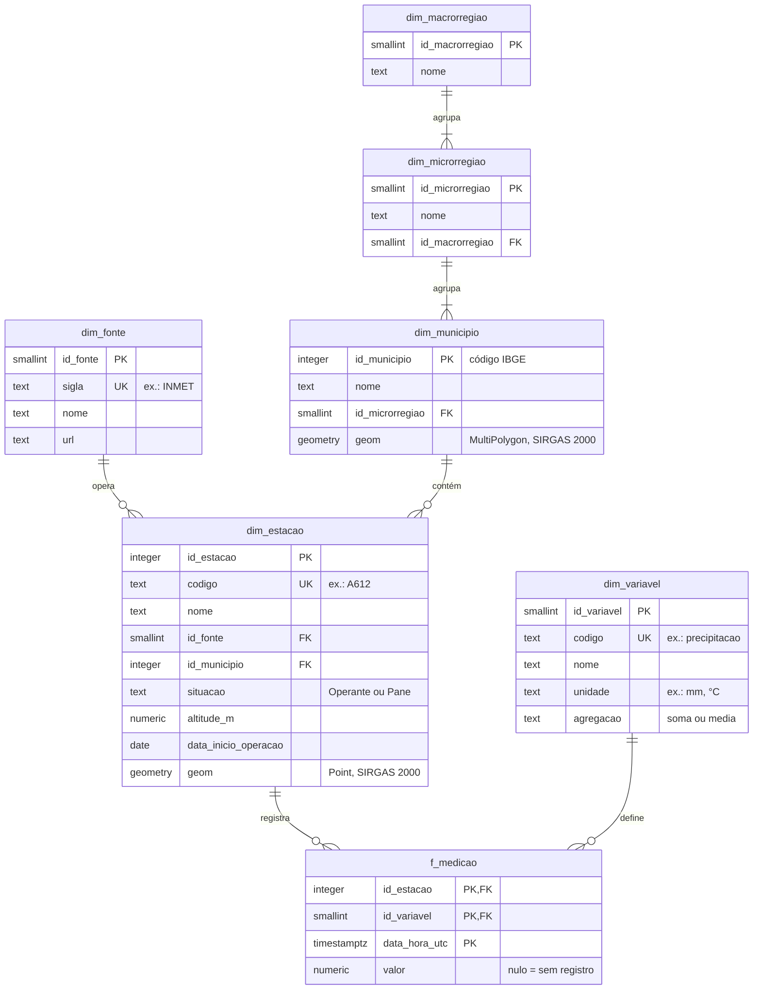

# Modelo de dados: banco ambiental do ES (MVP)

Modelo dimensional, com uma tabela de fato de medições em formato longo e dimensões compartilhadas. Decisão registrada na [ADR 0003](decisoes/0003-modelo-de-dados.md).

